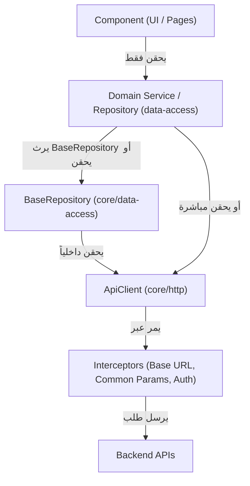
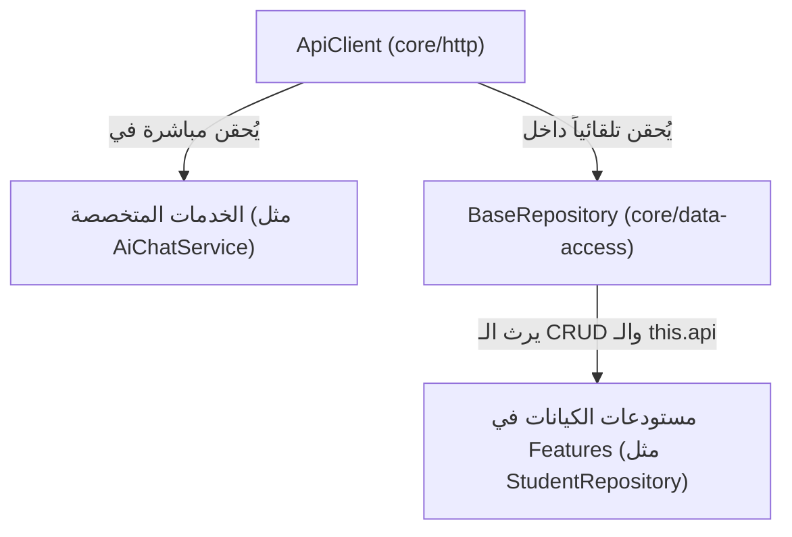

# معمارية HTTP وإعدادات التشغيل (Runtime Configuration & HTTP Architecture)

توثّق هذه الوثيقة بنية واستخدام شبكة الاتصال بـ APIs وإعدادات التشغيل (Configuration) في مشروع **مذاكرتي (Mozakrety)**، المصممة وفق أحدث معايير **Angular 22** المتوافقة كلياً مع **SSR (Server-Side Rendering)** ونظام الإشارات الحديث (**Signals & httpResource**) ومبدأ فصل المسؤوليات المعتمد في المشروع.

---

## 1. هرمية المعمارية وفصل المسؤوليات (Separation of Concerns)

يتبع المشروع معمارية صارمة تفصل بين طبقات النظام لمنع تداخل المسؤوليات:



> ⚠️ **قواعد معمارية هامة:**
> 1. **الكومبوننت (Component)** لا يحقن `ApiClient` مباشرة نهائياً ولا يكتب أي مسار URL لأي API؛ يتعامل **فقط** مع الـ Service / Repository في مجلد `data-access/`.
> 2. **المستودعات (Repositories)** في الـ Features ترث من `BaseRepository` لعمليات الـ CRUD، بينما الخدمات المتخصصة تحقن `ApiClient` مباشرة بدون طبقات وراثة زائدة.

### 1.1 حدود الملكية: مين يملك إيه؟ (Ownership Rules)

طبقة النقل المشتركة (`core/http` + `core/data-access` + `core/interceptors`) مسؤولة عن **السلوك العام فقط**، وكل Feature تملك استعلاماتها وبياناتها:

| المسؤولية | المالك | أمثلة |
|---|---|---|
| إرسال الطلب، الـ Base URL، الـ common params، الـ credentials، ترويسة اللغة، تحويل الأخطاء إلى `AppError` | `core` (عام، لا يعرف أي دومين) | `ApiClient.get/post/resource`، الـ interceptors، `BaseRepository` (CRUD عام مُعامَل بالأنواع) |
| مسارات الـ endpoints الخاصة بدور واحد فقط | `features/<feature>/data-access/` | `TeacherScheduleRepository extends BaseRepository<Schedule>` |
| مسارات الـ endpoints والعقود المشتركة بين **دورين أو أكثر** (عند وجود تداخل فعلي) | `domain/<capability>/` (عبر `@domain/<capability>`) | `CourseRepository` في `src/app/domain/courses/` |
| الـ DTOs وتحويلها لنماذج الدومين (DTO → Model mapping) | بجوار الـ repository المالك له (`features/<feature>/data-access/` أو `domain/<capability>/`) | `toCourse(dto: CourseDto): Course` |
| حالة البيانات (loading/list/selected/filters) | `features/<feature>/data-access/` عبر `@ngrx/signals` store خاص بالميزة | `StudentCoursesStore`، `TeacherCoursesStore` |
| بيانات جلسة/مستخدم يحتاجها التطبيق كله | `core` (فقط البنية التحتية العابرة للأدوار) | `AuthService`، `NavService` |

**ممنوع:**
- ❌ إضافة دوال خاصة بدومين إلى `ApiClient` أو `BaseRepository` (مثل `getTeacherCourses()` أو `getWalletBalance()`).
- ❌ إنشاء Store مركزي واحد في `core` يجمع بيانات كل الأدوار (كورسات + محفظة + طلاب...).
- ❌ وضع DTOs أو mappers خاصة بميزة داخل `core` أو `shared`.
- ❌ ميزة تستخدم repository أو store ميزة أخرى (Sheriff يمنع ذلك آلياً). لو نفس الـ endpoint أو المجال احتاجه دوران أو أكثر فعلياً، انقل الـ repository والعقد والـ DTOs إلى `src/app/domain/<capability>/` (راجع `src/app/domain/README.md`) بدلاً من نسخ الكود أو وضعه في `core`.

**متى أضيف شيئاً إلى `core`؟** فقط لو كان سلوكاً عاماً يحتاجه **كل** طلب أو **كل** الميزات بدون معرفة بالدومين (interceptor جديد، خيار جديد في `ApiRequestOptions`، دعم رفع ملفات عام). أي شيء فيه اسم كيان من الدومين مكانه الـ Feature.

---

## 2. المصدر الوحيد لعنوان الـ API (`apiBaseUrl`)

> **قاعدة ذهبية:** لا يتم كتابة رابط الـ API الأساسي داخل أي ملف كود TypeScript نهائياً.

### أين يتم تغيير `apiBaseUrl`؟
المكان **الوحيد والأساسي** في المشروع هو ملف:
📁 `public/config.json`

```json
{
  "apiBaseUrl": "https://api.mozakrety.com"
}
```

- **في بيئة التطوير (Development):** عدّل هذا الملف مباشرة وسيعمل المشروع عليه فوراً.
- **في بيئة الإنتاج (Production / Docker / CI/CD):**
  - **الطريقة 1 (الموصى بها في الحاويات):** ضبط متغير البيئة `API_BASE_URL` في بيئة السيرفر (Docker / Kubernetes)، حيث يقرأه السيرفر تلقائياً عند الإقلاع عبر `TransferState`.
  - **الطريقة 2 (Static Replacement):** استبدال ملف `config.json` داخل مجلد الـ build قبل تشغيل الحاوية دون الحاجة لإعادة بناء الكود (Build Once, Deploy Anywhere).

### ملف `src/app/core/config/app-config.ts`
يحتوي فقط على قيمة فارغة افتراضية لضمان سلامة أنواع TypeScript:
```typescript
export const DEFAULT_APP_CONFIG: AppConfig = {
  apiBaseUrl: '', // مجرد fallback فارغ لسلامة الأنواع
};
```

---

## 3. آلية عمل الـ SSR مع الـ TransferState و `provideAppInitializer`

1. **على السيرفر (Node.js SSR):**
   - عند إقلاع الطلب الأول، يقرأ السيرفر متغير البيئة `API_BASE_URL` (إذا وجد) أو يجلب `public/config.json`.
   - يخزن السيرفر الإعدادات المحمّلة داخل `TransferState` بمفتاح `moz.app_config` لتضمينها كـ JSON آمن داخل كود HTML المرسل للمتصفح.
2. **على المتصفح (Browser Client):**
   - أثناء الـ Hydration، يقرأ المتصفح الإعدادات فوراً من `TransferState` خلال **0 ملي ثانية وبدون أي Network Request إضافي**.
   - إذا تم تشغيل المتصفح في وضع الـ CSR البحت بدون SSR، يقوم التطبيق بجلب `/config.json` قبل بدء تشغيل الـ Routes عبر دالة الإقلاع الحديثة `provideAppInitializer` (البديل الرسمي لـ `APP_INITIALIZER` في Angular الحديثة).

---

## 4. البنية الأساسية للخدمات: `src/app/core/data-access/`

بدلاً من تكرار كتابة دوال الـ CRUD الروتينية في كل مستودع، يوفّر المشروع الكلاس الأساسي `BaseRepository` في مجلد مخصص متناسق مع طبقات الـ Features:
📁 `src/app/core/data-access/base-repository.ts`



---

### أ. مستودعات الكيانات والـ CRUD عبر `BaseRepository<TEntity, TId>`
لأي كيان يحتاج عمليات CRUD المتصلة بكنترولر الباك إند (راجع أيضاً الدليل المفصل في [src/app/core/data-access/README.md](file:///w:/Mashura/Front-End/mozakrety/src/app/core/data-access/README.md)):
- ترث الـ Repository من `BaseRepository<StudentEntity>` الموجودة في `src/app/core/data-access/base-repository.ts`.
- تحدد المسار الأساسي للكنترولر `protected readonly endpoint = '/students'`.
- تحصل تلقائياً على دوال مع فك غلاف `IResponse<T>` و `IResponseList<T>` تلقائياً والربط مع المسارات الافتراضية (`GetAll`, `GetList`, `GetById`, `Create`, `Edit`, `Patch`, `Delete`):
  - `getAll(options?)` ← `/students/GetAll`
  - `getPaginated(options?)` ← `/students/GetList` (يرجع `{ data, meta }`)
  - `getById(id, options?)` ← `/students/GetById/:id`
  - `create(dto, options?)` ← `/students/Create`
  - `update(id, dto, options?)` أو `update(dto, options?)` ← `/students/Edit/:id` أو `/students/Edit` (يدعم المعرّف في الرابط أو في الـ Body أو في `options.params`)
  - `patch(id, dto, options?)` أو `patch(dto, options?)` ← `/students/Patch/:id` أو `/students/Patch`
  - `delete(id, options?)` أو `delete(options?)` ← `/students/Delete/:id` أو `/students/Delete`
  - `resourceById(() => id)` (Signal Resource تفاعلي مع `.isLoading()` و `.value()` جاهزة للـ Skeleton بدون `subscribe`)
- وإذا اختلف اسم عملية واحدة في خدمة معينة، يكفي تعديل `override readonly endpoints = { ... }` في تلك الخدمة (أو كتابة `''` لاستخدام مسار الكنترولر مباشرة بدون Action).

**مثال تطبيقي كامل في Feature:**
```typescript
// src/app/features/student/data-access/student.repository.ts
import { Service } from '@angular/core';
import { BaseRepository, RepositoryEndpoints } from '@core/data-access';
import { Observable } from 'rxjs';

export interface StudentProfile {
  id: string;
  name: string;
  grade: number;
}

export interface CreateStudentDto {
  name: string;
  grade: number;
}

@Service()
export class StudentRepository extends BaseRepository<StudentProfile, string, CreateStudentDto> {
  // 1. تحديد اسم الكنترولر الأساسي فقط
  protected readonly endpoint = '/students';

  // 2. (اختياري) تخصيص أسماء العمليات المختلفة عن الافتراضي فقط:
  protected override readonly endpoints: Partial<RepositoryEndpoints> = {
    getAll: 'GetAllActive', // تصبح: GET /students/GetAllActive
  };

  // 3. طرق التحديث والحذف الثلاث مدعومة تلقائياً من BaseRepository:
  // repo.update('10', dto)                     -> PUT /students/Edit/10
  // repo.update({ id: '10', ...dto })          -> PUT /students/Edit
  // repo.update(dto, { params: { id: '10' } }) -> PUT /students/Edit?id=10

  // 4. كتابة أي دوال إضافية خاصة بالطلاب باستخدام this.api الموروثة:
  promoteStudent(id: string, nextGrade: number): Observable<void> {
    return this.api.post<void>(`${this.endpoint}/Promote`, { id, nextGrade });
  }
}
```

---

### ب. الخدمات المتخصصة غير المرتبطة بـ CRUD عبر حقن `ApiClient` مباشرة
للخدمات التي تحتاج الاتصال بـ HTTP ولكنها لا تمثل جدول أو كيان CRUD (مثل خدمات الذكاء الاصطناعي `AiTutorService`):
- تحقن `ApiClient` مباشرة (`private readonly api = inject(ApiClient);`) من `src/app/core/http/api-client.ts` بدون طبقة وراثة زائدة.

```typescript
// src/app/features/student/data-access/ai-tutor.service.ts
import { inject, Service } from '@angular/core';
import { Observable } from 'rxjs';
import { ApiClient } from '@core/http';

@Service()
export class AiTutorService {
  private readonly api = inject(ApiClient);

  ask(question: string): Observable<{ answer: string }> {
    return this.api.post<{ answer: string }>('/ai/ask', { question });
  }
}
```

---

### ج. استخدام الـ Signals الحديثة (`httpResource`) بالشكل المعماري الصحيح

وفقاً لتوثيق وتوصيات Angular الرسمية، يتم ربط الـ `resource` داخل الـ Service وتوفيره للكومبوننت بنمطين نظيفين:

#### النمط 1: عبر `resourceById` الموروثة في `BaseRepository` (الأسرع والأبسط)
بما أن `StudentRepository` ترث من `BaseRepository`، فـ `resourceById` جاهزة فوراً!

```typescript
// في الكومبوننت:
// src/app/features/student/pages/student-details/student-details.component.ts
import { Component, inject, signal } from '@angular/core';
import { StudentRepository } from '../../data-access/student.repository';

@Component({
  selector: 'app-student-details',
  template: `
    @if (student.isLoading()) {
      <p>جارٍ التحميل...</p>
    } @else if (student.error()) {
      <p class="text-danger">فشل في تحميل البيانات</p>
    } @else if (student.value(); as s) {
      <h3>{{ s.name }}</h3>
      <p>المرحلة: {{ s.grade }}</p>
    }
  `,
})
export class StudentDetailsComponent {
  private readonly studentRepo = inject(StudentRepository);

  readonly currentId = signal<string>('std-101');

  // الكومبوننت يطلب الـ Resource من الـ Repository مباشرة ويمرر الـ Signal
  readonly student = this.studentRepo.resourceById(() => this.currentId());
}
```

#### النمط 2: إدارة الـ State داخلياً في Service أو Store (للشاشات المركزية)
لو الخدمة تحقن `ApiClient` وتدير الـ Signal والـ Resource بداخلها:

```typescript
// src/app/features/student/data-access/student-state.service.ts
import { inject, Service, signal } from '@angular/core';
import { ApiClient } from '@core/http';
import { StudentProfile } from './student.repository';

@Service()
export class StudentStateService {
  private readonly api = inject(ApiClient);

  // إشارة المعرف المختار
  readonly selectedStudentId = signal<string | null>(null);

  // الـ Resource يعتمد تفاعلياً على selectedStudentId
  readonly studentResource = this.api.resource<StudentProfile>(() => {
    const id = this.selectedStudentId();
    return id ? `/students/${id}` : undefined;
  });

  selectStudent(id: string) {
    this.selectedStudentId.set(id);
  }
}
```

---

## 5. إضافة أو تعديل أو حذف معاملات الاستعلام العامة (Global Query Params)

تُدار المعاملات العامة في:
📁 `src/app/core/interceptors/common-params.interceptor.ts`

حالياً يمرر المشروع تلقائياً:
- `lang`: لغة العرض النشطة (`ar` أو `en`) المستخرجة تفاعلياً من `LocaleService`.
- `role`: دور المستخدم النشط (`student`, `teacher`, `parent`, `school`, `partner`, `admin`) المستخرج من `ThemeService`.

### مثال 1: إضافة معامل عام جديد (مثل `academicYear`)
افتح `common-params.interceptor.ts`:

```typescript
export const commonParamsInterceptor: HttpInterceptorFn = (req, next) => {
  if (req.context.get(SKIP_COMMON_PARAMS)) {
    return next(req);
  }

  const localeService = inject(LocaleService, { optional: true });
  const themeService = inject(ThemeService, { optional: true });

  let params = req.params;

  if (localeService && !params.has('lang')) {
    params = params.set('lang', localeService.currentLang());
  }

  if (themeService && !params.has('role')) {
    params = params.set('role', themeService.activeRole());
  }

  // ✅ إضافة معامل السنة الدراسية كمعامل افتراضي عام لكل الطلبات
  if (!params.has('academicYear')) {
    params = params.set('academicYear', '2026-2027');
  }

  return next(req.clone({ params }));
};
```

### مثال 2: حذف أو إيقاف معامل عام
إذا أردت إلغاء إرسال `role` مثلاً، يكفي مسح أو تعطيل سطر الشرط الخاص به في ملف `common-params.interceptor.ts`:
```typescript
// قم بحذف أو تعليق هذا الجزء:
// if (themeService && !params.has('role')) {
//   params = params.set('role', themeService.activeRole());
// }
```

---

## 6. استثناء طلب معين من الـ Base URL أو الـ Common Params

عند التعامل مع خدمات خارجية (مثل Google Cloud Storage, OpenAI, أو ملفات داخل `assets/`) نستخدم خيارات السياق (`HttpContext`):
📁 `src/app/core/http/http.context.ts`

```typescript
import { inject, Service } from '@angular/core';
import { ApiClient } from './api-client';
import { createApiContext } from './http.context';

@Service()
export class ExternalApiService {
  private readonly api = inject(ApiClient);

  // 1. طلب خارجي تماماً (تخطي الـ baseUrl والـ commonParams معاً)
  fetchExternalWeather() {
    return this.api.get('https://api.weather.com/v1/forecast', {
      context: createApiContext({ skipBaseUrl: true, skipCommonParams: true }),
    });
  }

  // 2. طلب لـ API الخاص ولكن بدون إرفاق lang أو role
  uploadRawLog(payload: unknown) {
    return this.api.post('/telemetry/logs', payload, {
      context: createApiContext({ skipCommonParams: true }),
    });
  }
}
```

---

## 7. إضافة Interceptors جديدة مستقبلاً (مثل Auth Bearer Token)

### الخطوة 1: أنشئ الـ Interceptor
في مجلد `src/app/core/interceptors/auth.interceptor.ts`:

```typescript
import { HttpInterceptorFn } from '@angular/common/http';
import { inject } from '@angular/core';
import { AuthService } from '../auth/auth.service';

export const authInterceptor: HttpInterceptorFn = (req, next) => {
  const authService = inject(AuthService, { optional: true });
  const token = authService?.accessToken();

  if (token && !req.headers.has('Authorization')) {
    const authReq = req.clone({
      headers: req.headers.set('Authorization', `Bearer ${token}`),
    });
    return next(authReq);
  }

  return next(req);
};
```

### الخطوة 2: تسجيله في مزودات الـ HTTP
افتح ملف:
📁 `src/app/core/providers/http.providers.ts`
وأضف المعترض داخل مصفوفة `withInterceptors`:

```typescript
export function provideMozHttp(): (Provider | EnvironmentProviders)[] {
  return [
    provideHttpClient(
      withFetch(),
      withInterceptors([
        apiBaseUrlInterceptor,
        commonParamsInterceptor,
        authInterceptor, // ✅ يُضاف هنا في الترتيب المناسب
      ]),
    ),
    provideAppInitializer(async () => {
      const configService = inject(AppConfigService);
      await configService.loadConfig();
    }),
  ];
}
```

---

## 8. فحص الجودة والتأكد من سلامة النظام

```bash
npm run typecheck   # التأكد من صحة الأنواع
npm run lint        # التأكد من عدم وجود مخالفات لمعمارية المشروع وقواعد Sheriff
npm test            # تشغيل كافة اختبارات الـ Unit Tests (ApiClient, Interceptors, Config, Repositories)
npm run build       # بناء نسخة الإنتاج والتأكد من سلامة الـ SSR
```
