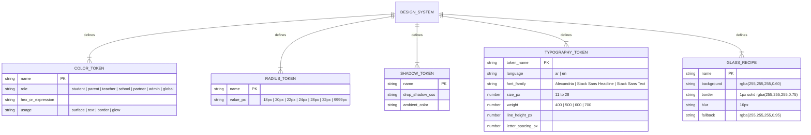

# Phase 1: Data Model & Component Entities — Design System Alignment

**Feature**: `004-design-system-alignment` (Phase 1.5)  
**Status**: Completed  
**Sources of Truth**: `docs/design/figma-components.json`, `docs/design/figma-deep.json`

---

## 1. Design Token Entity Schema



---

## 2. Component Variant Enums & Types

### 2.1 Button Component
- **`ButtonVariant`**: `'primary' | 'glass' | 'tinted'`
- **`ButtonSize`**: `'large' | 'medium' | 'small'`
  - `large`: Height `56px`, padding `ps-6 pe-6` (24px), font `16px/20.8px` (weight 600), gap `8px`, radius `9999px`.
  - `medium`: Height `44px`, padding `ps-4.5 pe-4.5` (18px), font `16px/20.8px` (weight 600), gap `6px`, radius `9999px`.
  - `small`: Height `36px`, padding `ps-3.5 pe-3.5` (14px), font `13px/16.9px` (weight 600), gap `6px`, radius `9999px`.
- **`ButtonState`**: `'default' | 'hover' | 'pressed' | 'focused' | 'disabled' | 'loading'`

### 2.2 Form Field Components
- **`FieldState`**: `'default' | 'focused' | 'filled' | 'error' | 'disabled'`
- **Dimensions**: Min-height `54px`, radius `18px`, horizontal padding `18px`.
- **Types**:
  - `FieldText`: Single-line text input with clear button and icon slots.
  - `FieldSelect`: Searchable dropdown selector with arrow indicator.
  - `FieldPhone`: Dial code selector combined with phone number input.
  - `FieldUpload`: File dropzone with progress indicator and upload action.

### 2.3 Tag Component
- **`TagTone`**: `'neutral' | 'primary' | 'success' | 'warning' | 'orange' | 'error'`
  - `neutral`: BG `#eef0f4`, Text `#12233a`
  - `primary`: BG `#e6eeff`, Text `#2a6eee`
  - `success`: BG `#ddf6ec`, Text `#13795b`
  - `warning`: BG `#fff1d6`, Text `#8a5a00`
  - `orange`: BG `#ffe8da`, Text `#a4480f`
  - `error`: BG `#fde4e1`, Text `#b42318`
- **`TagSize`**: `'regular' | 'small'`
  - `regular`: Height `28px`, padding `ps-3 pe-3`, font `13px`, radius `9999px`.
  - `small`: Height `24px`, padding `ps-2.5 pe-2.5`, font `11px`, radius `9999px`.

### 2.4 Banner Component
- **`BannerTone`**: `'info' | 'warning' | 'error'`
  - `info`: BG `#e6eeff`, Border `#c9d4ea`, Icon/Text `#2a6eee`
  - `warning`: BG `#fff1d6`, Border `#ffd88a`, Icon/Text `#8a5a00`
  - `error`: BG `#fde4e1`, Border `#ef5a4a`, Icon/Text `#b42318`
- **Properties**: `title: string`, `description: string`, `dismissible: boolean`. Height is content-driven (hug).

### 2.5 Card Components
- **`ChoiceCard`**: Single-select interactive card. Height hugs content. Displays selection radio or badge on start/end.
- **`CheckboxCard`**: Multi-select card with title, optional description, icon, and embedded checkbox.

### 2.6 Progress Steps Component
- **`StepState`**: `'completed' | 'active' | 'upcoming'`
  - `completed`: Primary background with checkmark icon.
  - `active`: Primary ring, active label with bold weight.
  - `upcoming`: Muted border and neutral text.

### 2.7 Skeleton Component
- **`SkeletonShape`**: `'line' | 'row' | 'card' | 'circle'`
  - `line`: Text line skeleton (height `14px`, rounded).
  - `row`: List item skeleton (avatar + 2 lines).
  - `card`: Surface skeleton with rounded corners (`22px`).
  - `circle`: Circular avatar skeleton (`44px` or custom).

---

## 3. Interactive State Transition Model

```mermaid
stateDiagram-v2
    [*] --> Default

    Default --> Hover : pointerenter (hover: hover)
    Hover --> Default : pointerleave
    
    Default --> Pressed : pointerdown
    Hover --> Pressed : pointerdown
    Pressed --> Hover : pointerup
    Pressed --> Default : pointerup (off-element)

    Default --> Focused : keyboard tab (focus-visible)
    Focused --> Default : blur

    Default --> Loading : loading=true
    Default --> Disabled : disabled=true

    Loading --> Default : loading=false
    Disabled --> Default : disabled=false
```

- **Hover**: Background shifts to primary-600 (or tint-hover); glow shadow intensifies slightly.
- **Pressed**: Background shifts to primary-700 (or tint-active); scale transforms down slightly (`scale(0.98)`).
- **Focus-Visible**: High-contrast outline ring: `2px solid var(--moz-primary-500)` with `2px` offset (`outline-offset: 2px`).
- **Disabled**: Opacity reduced to `50%` (`opacity: 0.50`), pointer events suppressed (`pointer-events: none`), cursor `not-allowed`.
- **Loading**: Interactive control displays animated SVG spinner (`20px`, `2.5px` stroke) ahead of label; user interactions ignored.
